# 流程图(Mermaid)

版本:v0.4(与 PRD v0.4 同步)  日期:2026-11-09
> 本文是**技术版**流程图(给研发评审用)。产品、运营、销售请看《02a-业务流程图》。
> 在支持 Mermaid 的工具中渲染(GitHub、飞书文档、Typora、VS Code 插件等)。
> 标【待确认】的节点,口径或通道尚未确定,图中画的是默认处理。

目录
1. 总体流程
2. 8 阶段主流程与迁移
3. 模块 A:进线校验 → 打标签 → 破冰
4. 模块 B:阶段感知的智能答复
5. 挖需采集子流程
6. 转人工状态机
7. 模块 E:主动触达(调度/追发/完成判定/事件触发)
8. 关单阶段分工(AI 与人工)
9. 模块 F:内容准入与检索
10. 模块 C:阶段标签同步
11. 时序图:APP 登录截图咨询

---

## 1. 总体流程

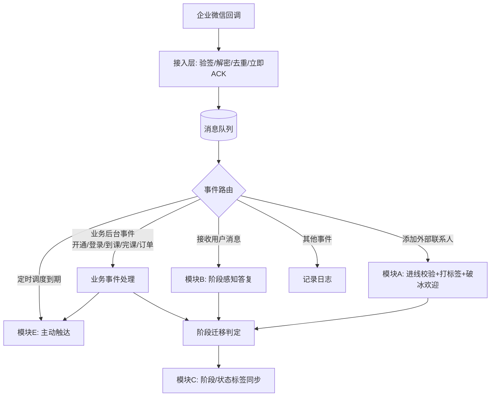

## 2. 8 阶段主流程与迁移

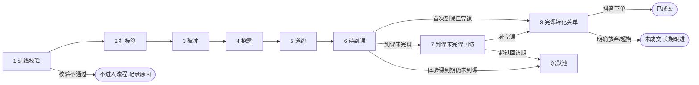

阶段迁移规则:

```mermaid
flowchart TD
    T[迁移触发源] --> U[用户行为<br/>首次回复/确认参加]
    T --> B[业务事件<br/>开通/登录/到课/完课/订单]
    T --> O[超时<br/>阶段停留超阈值]
    T --> M[人工操作 优先级最高]
    U --> J{目标阶段 晚于 当前阶段?}
    B --> J
    O --> J
    J -->|是 允许跳阶段| GO[写迁移日志 时间/来源/原因]
    J -->|否| CH{来自人工?}
    CH -->|是 允许回退| GO
    CH -->|否| IGN([忽略])
    M --> GO
    GO --> TAG[同步企微阶段标签<br/>移除旧阶段 添加新阶段]
```

## 3. 模块 A:进线校验 → 打标签 → 破冰(无 AI)

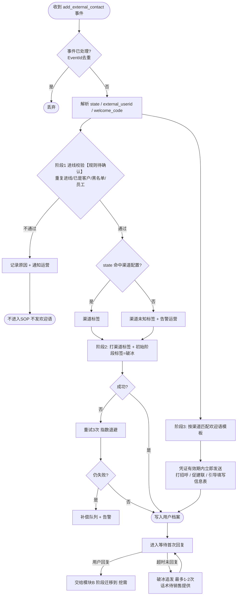

## 4. 模块 B:阶段感知的智能答复

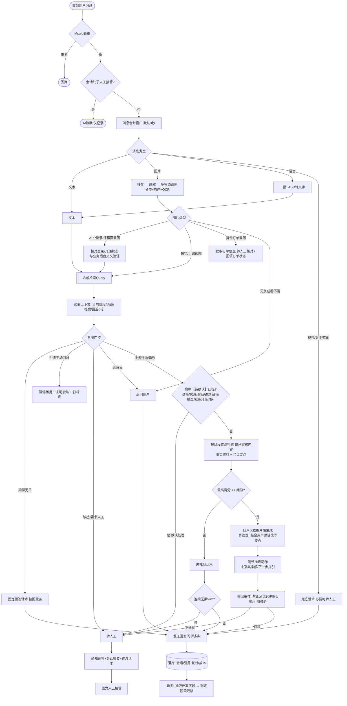

## 5. 挖需采集子流程(阶段 4)

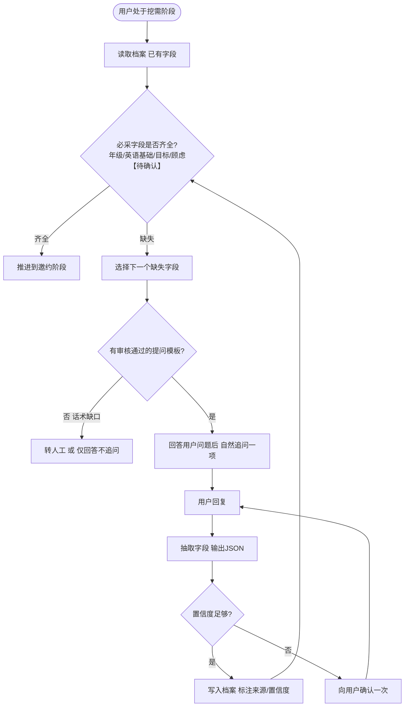

## 6. 转人工状态机

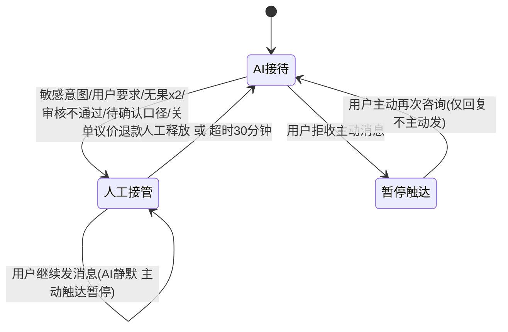

## 7. 模块 E:主动触达

### 7.1 调度与发送

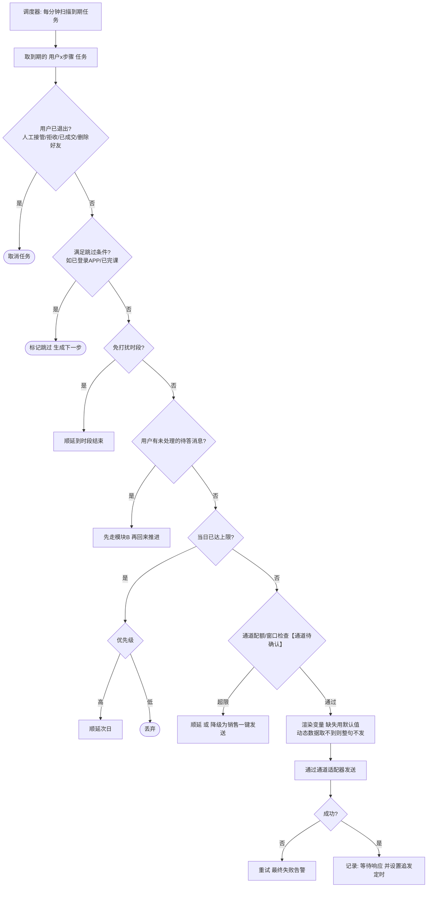

### 7.2 追发与完成判定

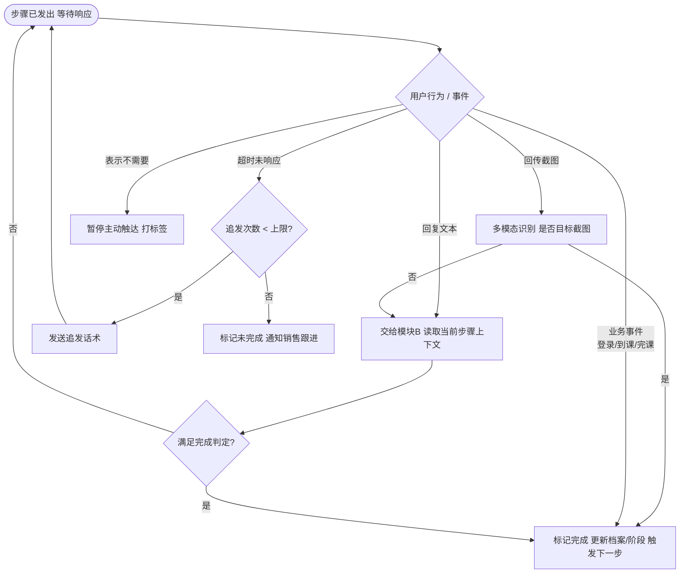

### 7.3 业务事件触发

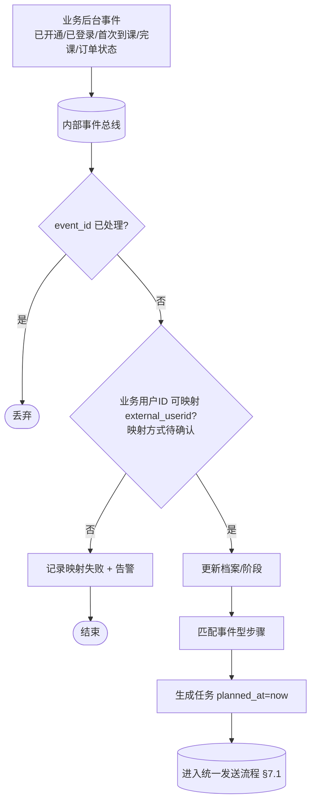

### 7.4 待到课阶段的典型分支(依据现有话术)

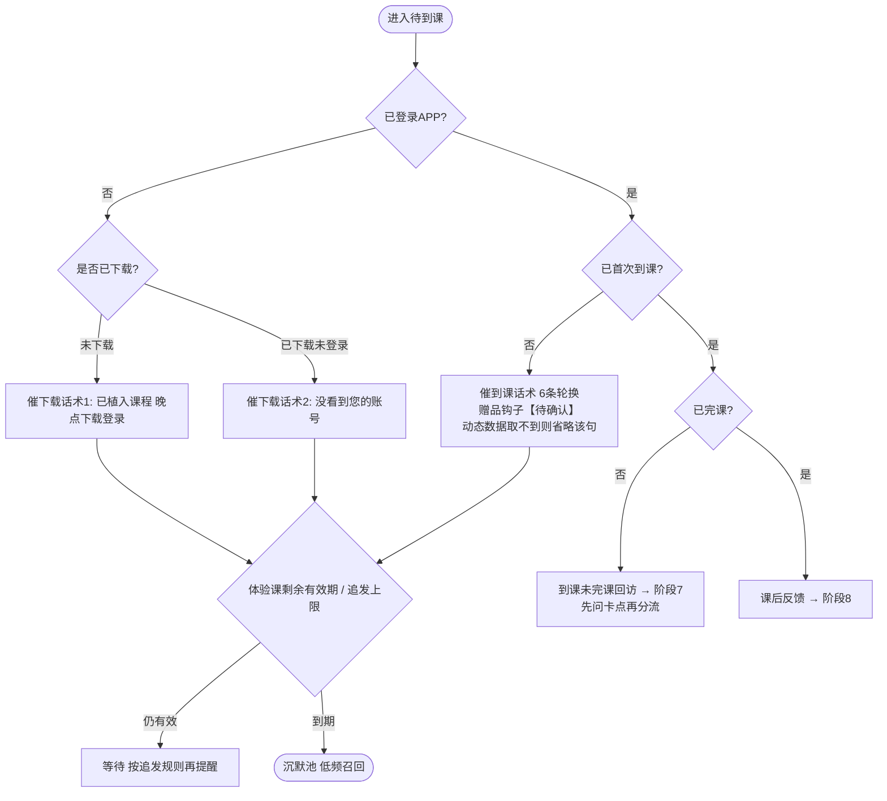

## 8. 关单阶段分工(阶段 8,默认方案 A:人工主导、AI 辅助)

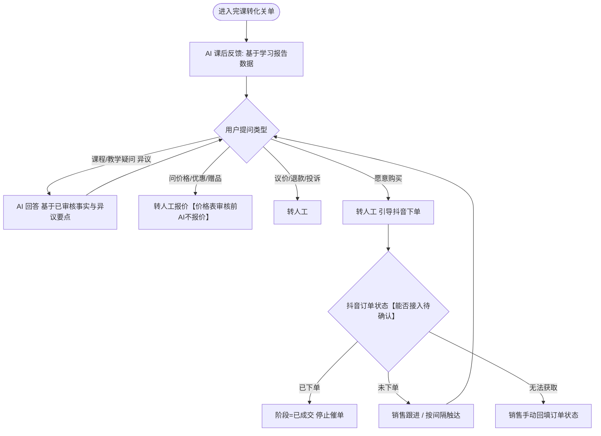

## 9. 模块 F:内容准入与检索

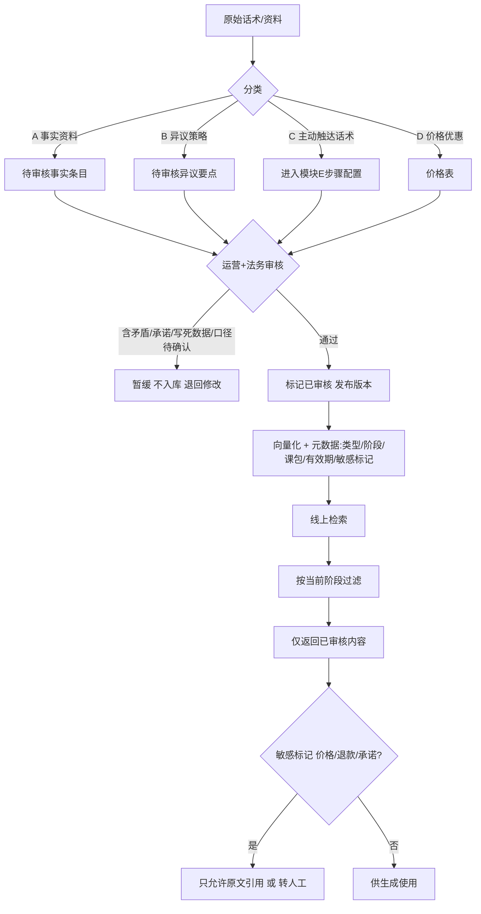

## 10. 模块 C:阶段与状态标签同步

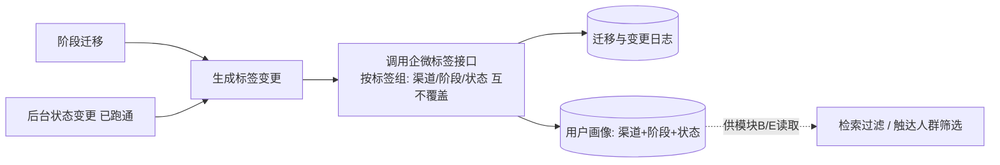

## 11. 时序图:APP 登录截图咨询

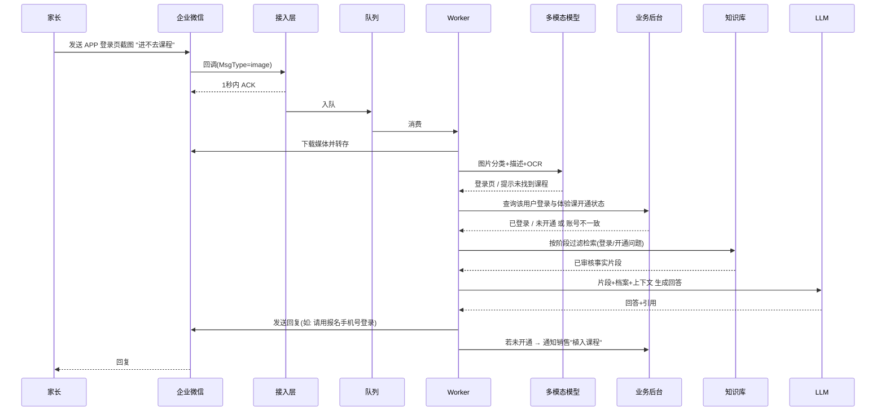
