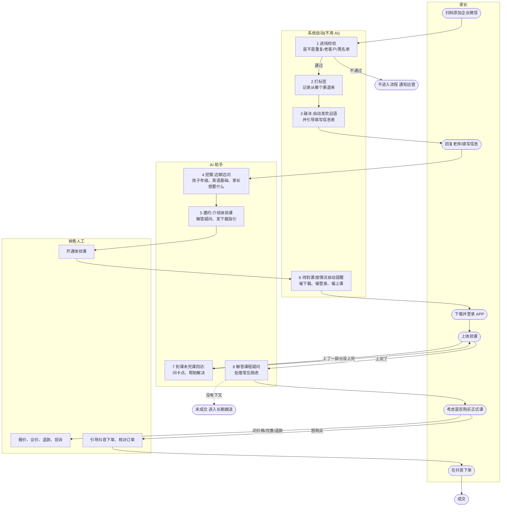
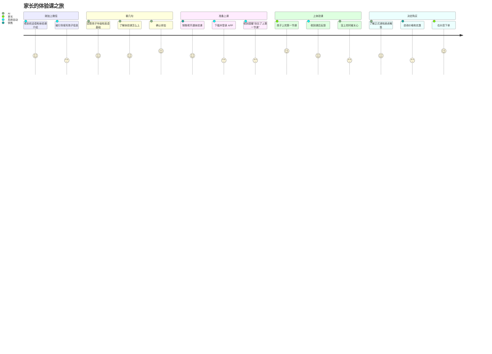
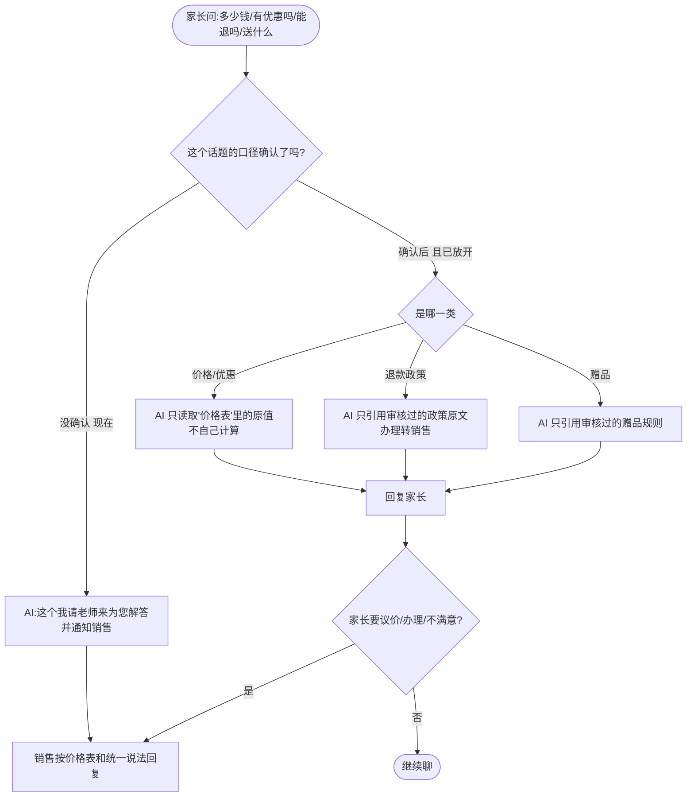
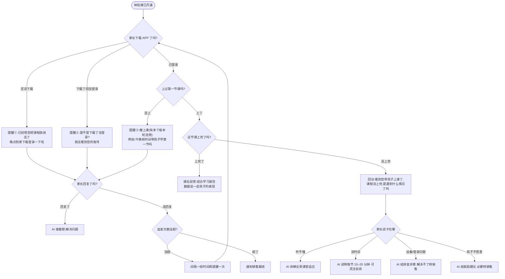
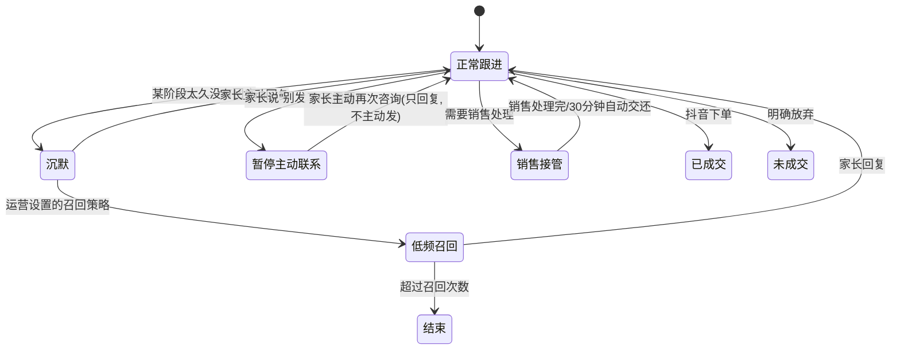
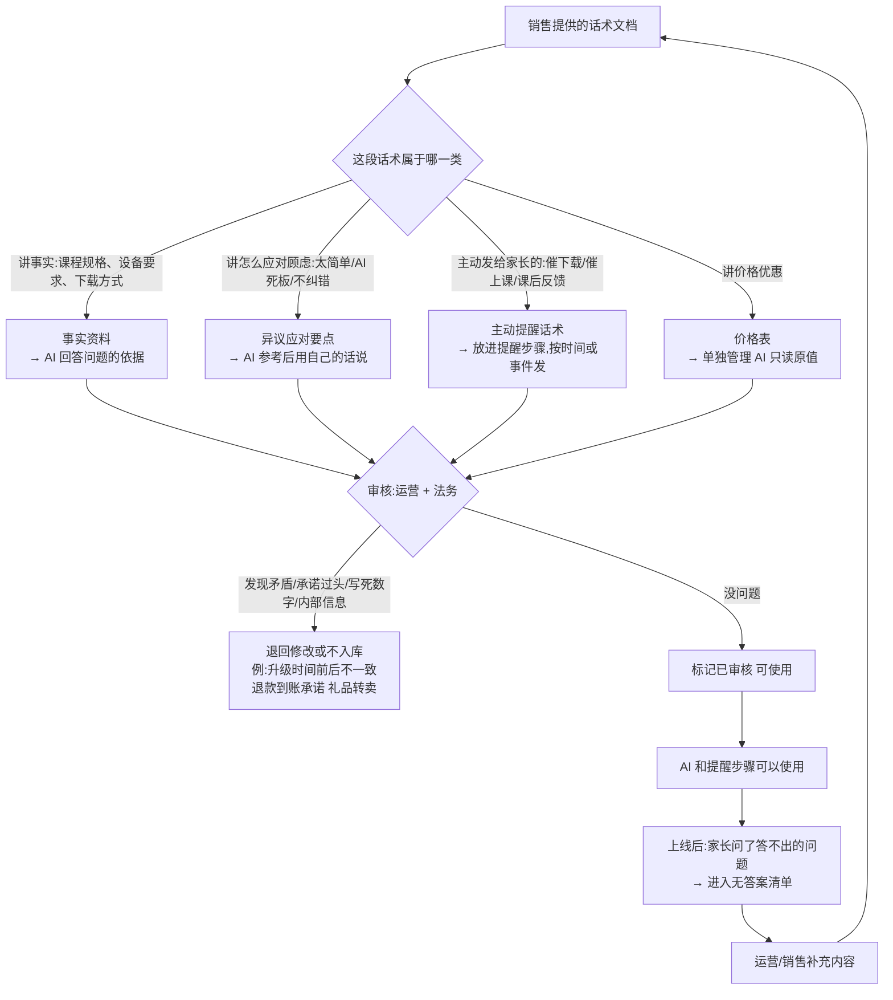

# 业务流程图(产品视角)

版本:v0.4  日期:2026-11-09
说明:这份是给产品、运营、销售看的,**不涉及技术实现**。技术版见《02-流程图》。
图例:🟦 系统自动(不用 AI,按规则) 🟩 AI 参与 🟧 销售人工 ⬜ 家长
标【待确认】的地方,公司口径还没定,图里画的是"口径没定前的默认做法"。

目录
1. 一张图看全程:谁在什么阶段做什么
2. 家长视角的旅程
3. 每个阶段的"进入—动作—出口"
4. AI 什么时候自己答、什么时候交给销售
5. 家长问到价格/退款时怎么处理
6. 体验课期间:什么情况发什么提醒
7. 用户不回复、拒绝、不想被打扰时怎么办
8. 内容是怎么从"销售话术"变成"AI 能用"的

---

## 1. 一张图看全程:谁在什么阶段做什么



**一句话总结**:前面(校验、打标签、欢迎语、提醒)系统按规则自动做;中间(挖需、邀约、答疑、回访)AI 来聊;涉及钱的事(报价、议价、退款)和开通体验课、核对订单,由销售来。

---

## 2. 家长视角的旅程

> 假设一个家长从进线到成交的完整体验。每一步标出"家长感受到什么"和"背后是谁在做"。



---

## 3. 每个阶段的"进入—动作—出口"

| 阶段 | 谁做 | 家长什么时候进入 | 做什么 | 什么时候算完成,进入下一阶段 |
|---|---|---|---|---|
| 1 进线校验 | 🟦 系统 | 刚加上好友 | 检查是否重复进线、是否老客户、是否黑名单【规则待确认】 | 通过则继续;不通过则不进入流程并通知运营 |
| 2 打标签 | 🟦 系统 | 校验通过 | 按进线渠道给用户打渠道标签,并标记当前阶段 | 标签打好 |
| 3 破冰 | 🟦 系统 → 🟩 AI | 标签打好 | 发欢迎语,引导填写信息表;家长回复后由 AI 接着聊 | 家长第一次回复【待确认标准】 |
| 4 挖需 | 🟩 AI | 家长回复了 | 边回答边了解:孩子年级、英语基础、学习目标、家长顾虑 | 必要信息问齐【必问项待确认】 |
| 5 邀约 | 🟩 AI + 🟧 销售 | 信息问齐 | AI 介绍体验课、解答疑问、发下载指引;确认参加后销售开通体验课 | 体验课已开通 |
| 6 待到课 | 🟦 系统(提醒)+ 🟩 AI(答疑) | 体验课已开通 | 家长没下载就催下载;下载了没登录就催登录;登录了没上课就催上课 | 家长上了第一节课 |
| 7 到课未完课回访 | 🟩 AI | 上了课但没上完 | 先问遇到什么情况,再按原因帮忙;解决不了就转销售 | 补完课 |
| 8 完课转化关单 | 🟩 AI + 🟧 销售 | 完课 | 课后反馈;AI 解答课程疑问和顾虑;价格、优惠、退款交销售;销售引导抖音下单 | 成交 或 明确放弃 |

阶段规则(用业务话说):
- 家长同一时间只在一个阶段。
- 允许"跳阶段":比如家长一加上就说"我已经开通体验课了",就直接跳过前面的。
- 销售可以随时手动修改家长所在阶段。
- 家长很久没回应,会进入"沉默池",之后低频召回。

---

## 4. AI 什么时候自己答、什么时候交给销售

```mermaid
flowchart TD
    Q([家长发来一条消息]) --> W{这个会话现在是销售在接管吗?}
    W -->|是| STAY[AI 不插话,只记录]
    W -->|否| T{家长发的是什么}
    T -->|文字| K
    T -->|图片| IMG["看图:是 APP 截图?订单截图?<br/>还是看不清/无关"]
    T -->|视频/文件| ASK0[回复:已收到,请用文字描述<br/>或转销售]
    IMG -->|APP 登录或课程页| CHECK["对照系统里的登录/开通记录<br/>以系统记录为准"] --> K
    IMG -->|抖音订单截图| TOS[转销售核对订单]
    IMG -->|看不清或无关| ASK1[请家长再发清楚一点/说明想问什么]
    K{家长想问的是} 
    K -->|课程内容、怎么上课、设备、下载登录| ANS[AI 回答<br/>依据:销售已审核的资料]
    K -->|担心课程效果/难度/AI 好不好| OBJ[AI 回答<br/>依据:销售话术中的应对要点,用自己的话说]
    K -->|价格、优惠、赠品、退款| HUM1[转销售【口径确认前】]
    K -->|投诉、情绪激动、要求找真人| HUM2[转销售]
    K -->|闲聊、与课程无关| CHAT[礼貌拉回:我主要负责课程咨询]
    K -->|说"别发了/不需要"| STOP[停止主动提醒 并告知销售]
    ANS --> NEXT[回答后自然问一个还没了解的信息<br/>例如孩子几年级]
    OBJ --> NEXT
    HUM1 --> NOTE[给家长一句"稍后老师为您解答"<br/>同时给销售一份对话小结]
    HUM2 --> NOTE
    TOS --> NOTE
```

**转销售时 AI 给家长说什么**:一句过渡话(如"这个问题我请老师来帮您解答哈"),同时给销售发一份**对话小结**(家长在哪个阶段、已了解的信息、这次想问什么、情绪如何),销售不用从头问。

---

## 5. 家长问到价格/优惠/退款时怎么处理

> 因为价格、优惠、退款的对外口径还没确认(详见《06》法务部分),**口径确认前,AI 一律不回答,转销售**。口径确认后,运营在后台打开开关即可放开,不需要改程序。



**现在 AI 不会说的话**(口径未确认,所以默认不说):
- 具体价格、优惠券、满减、实付价格
- 赠品有哪些、怎么领
- 退款多久到账、是否"秒退"
- 升级时间(话术里"下周升级"和"已完成升级"互相矛盾)
- 用的是哪家大模型/是否自研
- 体验课"价值 99 元"的说法

---

## 6. 体验课期间:什么情况发什么提醒

这是"待到课"阶段的核心。**提醒按家长实际做到哪一步来选,不是所有人发一样的。**



**提醒的几条"底线规矩"**(系统强制,运营改不了):
- 晚上 21:30 到早上 8:00 不发。
- 每个家长每天最多 5 条主动消息(超了,不重要的丢掉,重要的第二天发)。
- 一个家长同时最多一个"等回复"的提醒,不连环轰炸。
- 家长说"别发了",立刻停止所有主动提醒。
- 话术里的数据(如"86% 同学已完课""平均开口 57 次")**必须是真实数据**,取不到就整句不发,不写死。

---

## 7. 用户不回复、拒绝、不想被打扰时怎么办



---

## 8. 内容是怎么从"销售话术"变成"AI 能用"的

> 不是把销售的话术文档直接丢给 AI。要先分类、审核,**审核通过的才能用**。



**当前话术里要先处理的几类问题**(详见《08》):
| 问题 | 例子 |
|---|---|
| 前后矛盾 | 一处说"下周升级",另一处说"已经升级完成" |
| 承诺过头 | "当天退款到账""极速秒退" |
| 写死的数据 | "86% 同学已完课,平均开口 57 次" |
| 不该说的 | "礼品可以挂二手平台卖三四百" |
| 价格对不上 | 3699 减 1100 优惠券不是 2250 |
| 缺话术 | 挖需怎么问、没到课的各种原因、抖音下单怎么引导 |
