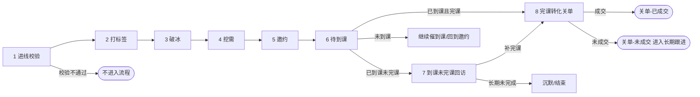

# 业务流程与阶段设计(以公司真实流程为准)

版本:v0.1  日期:2026-11-09
本文档**取代** PRD 附录 A 中按竞品推断的 SOP 草案。竞品只作为话术形态参考,阶段划分以本文为准。
各阶段的"进入/退出条件、关键动作"是我根据阶段名称做的合理推断,标【待确认】的需要销售负责人核对。飞书话术文档我无法访问,话术内容尚未纳入。

---

## 1. 主流程:8 个阶段

```
进线校验 → 打标签 → 破冰 → 挖需 → 邀约 → 待到课 → 到课未完课回访 → 完课转化关单
```



用户在任一时刻只处于**一个主阶段**。阶段本身就是一类标签(生命周期标签),与渠道标签、状态标签分组存放。

---

## 2. 阶段逐一说明

| # | 阶段 | 目标 | 进入条件【待确认】 | 退出条件【待确认】 | 主要动作 | AI 参与程度 |
|---|---|---|---|---|---|---|
| 1 | 进线校验 | 判断进线用户是否合格、是否已有归属 | 收到添加好友事件 | 通过/不通过 | 校验渠道参数、是否重复进线、是否已是客户、是否员工/同行/黑名单 | 无(规则) |
| 2 | 打标签 | 打上渠道标签与初始阶段标签 | 校验通过 | 标签打入成功 | 渠道标签、来源、初始阶段=破冰 | 无(规则) |
| 3 | 破冰 | 建立联系,让用户回复 | 打标签完成 | 用户首次有效回复 | 欢迎语、自我介绍、问称呼/孩子年级 | 欢迎语无 AI;回复后用 AI |
| 4 | 挖需 | 弄清用户的需求、痛点、决策因素 | 用户已回复 | 关键需求信息已采集(年级、基础、痛点、意愿)【待确认必采字段】 | 提问、倾听、记录档案 | 高:AI 追问+RAG 答疑 |
| 5 | 邀约 | 让用户报名/预约体验课 | 需求已明确 | 用户确认参加体验课 | 介绍课程价值、解决顾虑、发起邀约、下发报名/激活指引 | 高:基于需求给出邀约话术 |
| 6 | 待到课 | 保证用户准时到课 | 已报名 | 用户到课 / 开课日结束仍未到 | 开课前提醒、检查 APP/教材准备、开课日提醒 | 规则触发为主,用户提问时 AI 答 |
| 7 | 到课未完课回访 | 让到课但没学完的用户补完 | 已到课但未完课 | 完课 / 超过回访期限 | 了解卡点、协助解决、鼓励补课 | 中:AI 答疑、识别卡点,必要时转人工 |
| 8 | 完课转化关单 | 完课用户转化为付费并关单 | 已完课 | 成交 / 明确放弃 / 超过跟进期限 | 效果反馈、价值强化、报价与优惠、异议处理、促单、收款引导 | 中低:建议 AI 辅助、人工主导关单【待确认,见 §5】 |

---

## 3. 阶段与已有模块的对应

| 阶段 | 对应模块 | 说明 |
|---|---|---|
| 1 进线校验 | 模块 A(扩展) | 原"渠道识别"扩展为校验:增加重复进线、已有客户、黑名单等规则 |
| 2 打标签 | 模块 A | 不变 |
| 3 破冰 | 模块 A 欢迎语 + 模块 B | 欢迎语无 AI;用户回复后进入 B |
| 4 挖需 | 模块 B(需新增"采集目标") | AI 回复时带"本阶段要采集的字段",在答疑过程中自然追问 |
| 5 邀约 | 模块 B + 模块 E | 对话中触发邀约;邀约后下发报名指引 |
| 6 待到课 | 模块 E | 定时提醒、状态检查 |
| 7 到课未完课回访 | 模块 E(业务事件触发)+ 模块 B | 依赖课程后台"到课/完课"事件 |
| 8 完课转化关单 | 模块 E + 模块 B + 人工 | 事件触发 + 对话 + 人工关单 |
| 阶段变更 | 模块 C | 阶段迁移=用户状态变更,复用标签同步 |

---

## 4. 阶段迁移规则

**迁移触发源**
1. 用户行为:首次回复(破冰→挖需)、确认参加(邀约→待到课)。
2. 业务事件:已报名、已到课、已完课、已支付(来自业务后台)。
3. 超时:某阶段停留超过阈值未推进(如破冰后 48 小时无回复→进入"沉默"待跟进)。
4. 人工操作:销售手动改阶段(优先级最高)。

**规则**
- 阶段只能向前推进,或进入"沉默/流失"支线;允许人工回退。
- 每次迁移记录:何时、从哪到哪、触发原因,供复盘。
- 迁移时同步企微阶段标签(旧阶段标签移除、新阶段标签添加),沿用模块 C 通道。
- 一个用户可能"跳阶段"(例如加好友即报名),系统要允许跳过中间阶段而不是卡住。

**异常支线【待确认】**
- 沉默:各阶段长期无响应 → 沉默池,按低频策略召回。
- 拒绝:明确表示不需要 → 停止主动触达。
- 转人工:任何阶段触发转人工 → AI 静默,阶段不变。
- 已成交:进入售后/续报,不属于本期流程。

---

## 5. 范围变化提醒:成交环节

> 更新(读取销售话术后):成交和退款都在**抖音平台**完成,系统不收款。因此"关单"的含义是引导下抖音订单并跟进订单状态,详见《08-销售话术分析与入库规范》§1。下表三个方案仍然适用,只是"收款"部分不由我们的系统承担。

第 8 阶段"完课转化关单"包含报价、优惠、促单、收款引导。我之前建议"成交环节不在一期范围"(待确认问卷 P2),**现在需要重新决策**:

| 方案 | 说明 | 风险 |
|---|---|---|
| A 人工主导,AI 辅助 | AI 生成建议话术、提醒时机、整理用户画像;报价和关单由销售发送 | 风险低,推荐一期采用 |
| B AI 发话术、人工兜底 | AI 可以发价格和优惠信息,遇到议价、退款转人工 | 价格/优惠必须来自权威配置,不能让模型自己生成 |
| C 全自动关单 | AI 全程完成报价与收款引导 | 合规与误承诺风险高,不建议 |

**价格、优惠、有效期等信息必须来自结构化配置(价格表),不允许 AI 根据话术文档自行推断。**

---

## 6. 销售话术入 RAG:如何处理

你说话术可以放进 RAG。方向可行,但需要先区分话术的类型,不同类型用法不同。我没看到文档,以下是通用处理规范,拿到内容后再细化。

### 6.1 话术分类

| 类型 | 例子 | 怎么用 |
|---|---|---|
| 知识类(事实) | 课程内容、时长、上课方式、退款政策 | 作为 RAG 事实依据,**回答只能引用这类内容** |
| 话术类(表达) | 破冰开场、共情、鼓励、促单话术 | 作为 RAG 风格参考,按阶段检索,AI 改写后使用,不可当事实依据 |
| 异议处理类 | "太贵了""没时间""孩子不感兴趣" | 按"异议类型"检索,作为应对策略 |
| 流程类 | SOP 步骤、什么时候发什么 | **不放进 RAG**,应放进模块 E 的步骤配置,由系统按时间/事件主动发 |
| 价格优惠类 | 价格、折扣、截止日 | **不放进 RAG**,放结构化价格表,由规则读取 |

### 6.2 入库时每条话术需要的标签
`阶段(8 选 1 或多个)`、`类型(知识/话术/异议/…)`、`适用渠道`、`适用人群(年级等)`、`异议类型`、`有效期`、`来源与版本`、`是否经过合规审核`。

检索时按"用户当前阶段"过滤,**避免在破冰阶段检索出关单话术**。

### 6.3 需要销售提供的最低材料
1. 每个阶段的标准话术(含多个版本);
2. 常见异议 + 标准应对;
3. 课程/产品/价格/退款等事实资料,与话术分开;
4. 禁止说的话清单。

### 6.4 风险提示
- 销售话术往往带夸大、承诺性表述(如"保证提分""一定见效"),直接入库会让 AI 学去。入库前需要合规审查,并建立禁止承诺清单。
- 话术里常含个人化的称呼、微信号、联系方式、活动截止日,需清洗。
- 话术与事实资料冲突时,以事实资料为准。

---

## 7. 对既有文档的影响(已于 v0.4 全部同步)

| 文档 | 状态 |
|---|---|
| 01-PRD | ✅ v0.4 已重写 |
| 02-流程图 | ✅ v0.4 已重写 |
| 03-技术方案 | ✅ v0.4 已重写(阶段引擎、受限话题、内容准入) |
| 04-运营后台 | ✅ v0.4 已重写 |
| 05-指标 | ✅ v0.4 已重写 |
| 06-问卷 | ✅ v0.4 已重写(新增法务/合规部分) |

以下保留原调整清单作为记录:

| 文档 | 当时需要调整的内容 |
|---|---|
| 01-PRD | 模块 A 增加"进线校验";模块 B 增加"阶段感知与采集目标";模块 E 的 SOP 改为围绕 8 阶段;"不做成交"需要改为按 §5 决策;附录 A.2/A.4 草案作废 |
| 02-流程图 | 增加 8 阶段主流程图与阶段迁移图 |
| 03-技术方案 | 增加阶段状态机与迁移记录表;知识库元数据增加阶段与类型;价格表独立于知识库 |
| 04-运营后台 | 增加"阶段看板""话术库按阶段管理""价格表"页面 |
| 05-指标 | 北极星指标可能改为"完课转化率/成交率";增加各阶段停留时长与转化率 |
| 06-问卷 | 增加阶段定义、关单方式等问题 |

以上调整等你提供销售话术和阶段定义后一次性更新,避免反复改。

---

## 8. 待确认问题(针对新流程)

| # | 问题 | 回答人 |
|---|---|---|
| F1 | 进线校验具体校验什么?(重复进线、已有客户、黑名单、员工/同行、地域、年龄) 校验不通过怎么处理 | 运营/销售 |
| F2 | 破冰的完成标准是什么?(用户回复一句话就算,还是需要回复指定内容) | 销售 |
| F3 | 挖需必须采集哪些字段?采集不全能否进入邀约 | 销售 |
| F4 | 邀约的动作是什么?(报名链接、预约、拉群、发课程入口) 邀约成功的判定 | 销售 |
| F5 | "到课""完课"各自的定义和数据来源?(课程后台哪个字段) | 研发/课程运营 |
| F6 | 到课未完课回访的时间节点和次数上限 | 销售 |
| F7 | 完课转化关单的流程:谁来报价、怎么收款、能否发优惠、关单后动作 | 销售负责人 |
| F8 | 各阶段超时多久算沉默?沉默用户是否召回,怎么召回 | 运营 |
| F9 | 是否允许跳阶段、回退阶段 | 销售 |
| F10 | 阶段标签是否已存在于企微标签体系?命名规则 | 研发/运营 |
| F11 | 销售话术文档:能否导出为 Word/PDF/Markdown 发我,或提供可访问的链接 | 产品 |
