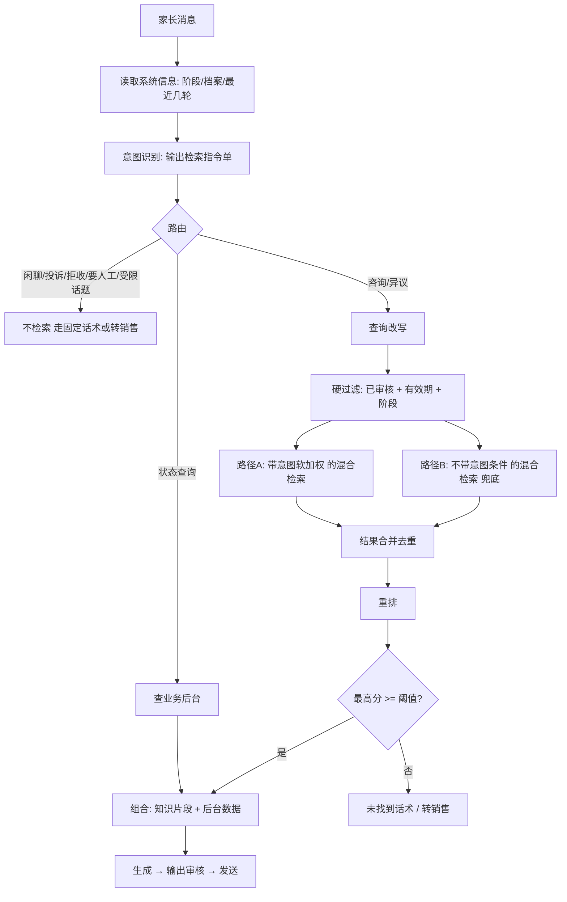

# 意图识别 × RAG 检索:调研与方案建议(产品视角)

版本:v0.1  日期:2026-11-09
目的:弄清楚两件事——
1. 意图识别出来的内容,**具体怎么用到 RAG 检索里**?
2. 这样做,**为什么能让检索更准**?在我们的业务里该怎么落地、怎么证明有效?

资料来源与可信度说明:
- 文中带链接的部分来自公开资料,我读到的是**搜索摘要,没有逐篇通读全文**。具体数字是各来源在**自己的数据集**上的结果,不代表在我们业务上也是这个效果,**必须用我们自己的评测集验证**。
- 没有链接的内容,是我基于通用做法和本项目场景的判断,已标明。

---

## 1. 先说结论(一页看完)

1. **意图识别不是为了"分类好看",而是为了给检索"缩小范围、换对问法、选对路"。** 家长一句话直接丢给向量库,命中的是"语义最像"的内容,不一定是"该用的"内容。意图识别先把这句话变成一份**结构化的检索指令**,再去检索。
2. **意图结果在检索里有 5 种用法**:路由(要不要检索、去哪检索)、过滤(只在哪些内容里找)、改写(把口语问题改成适合检索的问法)、扩展(一个问题拆成多个问法)、加权/重排(让该靠前的靠前)。
3. **最关键的一条:意图标签体系必须和内容库的标签是"同一套词表"。** 否则识别出来的意图,在内容库里没有对应的标签可以用,这一步就白做。这是产品要牵头定的东西。
4. **过滤是把双刃剑。** 意图判错 + 硬过滤 = 正确答案被直接过滤掉,而且这种错误**很难发现**(没召回就没人知道漏了)。所以:硬条件只用"高确定性"的字段(阶段、审核状态、有效期),意图类的字段用"软加权",并留一条"不过滤"的兜底路。
5. **业界的共识是:真正稳定提升的是几个朴素方法的组合——混合检索(语义+关键词)、重排、适度的查询改写。** 花哨的高级技巧不一定有效,个别场景还会比不用 RAG 更差([2026 年一项多轮对话 RAG 对比研究](https://arxiv.org/html/2602.09552))。所以一期不要上太多花样。
6. **对我们最有价值的不是"提准确率"本身,而是"防止答错"**:通过意图 + 阶段 + 受限话题,让 AI 在不该答的时候不答(价格、退款),在该答的范围里答得准。

---

## 2. 意图识别到底产出什么

很多人以为意图识别就是"贴一个标签"。要给检索用,它需要产出一份**结构化结果**,我把它叫"检索指令单":

| 字段 | 含义 | 举例(家长问:"你们这个 AI 是不是很死板啊,我家孩子三年级,怕学不进去") |
|---|---|---|
| 意图大类 | 这是要答疑、要处理顾虑、闲聊、投诉…… | 异议(对课程有顾虑) |
| 话题/异议类型 | 更细的主题,和内容库标签对应 | 异议类型 = "AI 死板" |
| 受限话题 | 是否碰到口径未确认的话题 | 否 |
| 关键实体 | 问题里的关键信息 | 年级 = 三年级 |
| 家长当前阶段 | 来自系统记录,不是模型猜的 | 待到课(来自业务后台) |
| 改写后的问题 | 去掉口语和指代,适合检索的完整问法 | "家长担心 AI 外教课程流程化、不够灵活,如何回应" |
| 置信度 | 模型对这次判断有多确定 | 0.82 |
| 是否需要检索 | 有些话不需要查资料 | 是 |

**检索不是直接拿"用户原话"去查,而是拿这份指令单去查。** 这就是"意图识别提升检索准确性"的全部逻辑。

---

## 3. 意图结果在检索里的 5 种用法

### 3.1 路由:要不要检索、去哪检索
| 意图 | 检索动作 |
|---|---|
| 闲聊、无意义 | **不检索**,直接固定话术 |
| 受限话题(价格、退款等) | **不检索**,转销售(口径确认前) |
| 要找真人、投诉 | **不检索**,转销售 |
| 事实类咨询(怎么下载、设备要求) | 查"事实资料"库 |
| 异议/顾虑 | 查"异议策略"库 |
| 要状态查询(我登录了吗、课开了吗) | **不查知识库**,查业务后台的记录 |
| 关单阶段的价格咨询(口径放开后) | 查"价格表"(结构化数据),不查文本库 |

**价值**:很多错误回答来自"不该检索时检索了"(比如问价格,检索到一段旧话术就答了)。路由先把这些挡掉。这是对我们最重要的一步。
> 业界资料也提到,可以先加一个分类器,决定是直接回答、单次检索,还是多次检索,**不一定每次都要走 RAG**([来源](https://www.cnblogs.com/hdbdn/articles/22644196))。

### 3.2 过滤:只在哪些内容里找
把检索范围缩小到"可能相关"的内容,排除"一定不该用"的内容。

| 过滤条件 | 来源 | 确定性 | 用法 |
|---|---|---|---|
| 审核状态 = 已通过 | 内容库 | 100% | **硬过滤** |
| 在有效期内 | 内容库 | 100% | **硬过滤** |
| 适用阶段包含当前阶段 | 系统记录的阶段 | 高 | **硬过滤**(例:破冰阶段不出现关单话术) |
| 内容类型(事实/异议) | 意图路由 | 中 | 有把握时硬过滤,否则软加权 |
| 异议类型 = "AI 死板" | 意图识别 | 中 | **软加权**,不要硬过滤 |
| 适用课包(体验/学霸/培优) | 家长所问课包 | 中 | 软加权 |
| 适用年级 | 档案 | 中 | 软加权 |

**为什么要分硬/软?** 公开资料里有一个常见的区分:先过滤再检索(预过滤)在过滤条件很具体时很有效,能大幅缩小搜索范围([Splunk 的说明](https://www.splunk.com/en_us/blog/artificial-intelligence/vector-database-operations.html));但前提是过滤条件本身是对的。意图是模型猜的,猜错就把答案过滤掉了。所以"猜出来的"只做加权,"系统确定的"才做硬过滤。(这条是我的判断,不是某篇文章的原话。)

### 3.3 改写:把口语问题改成能检索到的问法
家长的话常常是口语、省略、指代:
- "那这个能退吗?"(这个是什么?)
- "孩子不爱说话怎么办"(和哪个异议对应?)
- "下了登不上"(下了什么?登什么?)

改写要做三件事:
1. **补全指代**:结合最近几轮对话,把"这个"还原成具体对象。
2. **口语转检索语言**:"登不上" → "APP 登录失败 / 登录方式 / 报名手机号"。
3. **提炼核心问题**:去掉寒暄和情绪。

多轮对话场景下,查询改写和混合检索加重排的组合被一些研究验证有效([多轮 RAG 检索研究](https://arxiv.org/html/2606.28352))。

### 3.4 扩展:一个问题拆成多个问法
家长问一个问题,内容库里可能有多种说法。两种常见做法:
- **多查询**:让模型把一个问题改写成几个同义问法,分别检索,合并去重,提升召回([介绍](https://www.cnblogs.com/xymhh/articles/22589674))。
- **假设文档(HyDE)**:先让模型写一段"理想答案",用这段话去检索,弥补"问题和答案措辞差距大"的问题。上述多轮对话对比研究里,HyDE 与重排、混合检索一起被归为稳定优于基础 RAG 的方法([来源](https://arxiv.org/html/2602.09552))。

**代价**:额外的模型调用,增加响应时间和成本。**已确认:一期准确率优先,不设时延硬指标**,所以可以使用。建议先用评测集对比,只保留有明显提升的做法,避免无效增加成本。

### 3.5 加权与重排:让该靠前的靠前
- **混合检索**:语义(向量)检索 + 关键词(BM25)检索合并。语义能懂"登不上=登录失败",关键词能精确命中"KET""Power Up""学霸包"这类专有名词。
- **重排**:用更精细的模型,对召回的前 N 条重新打分排序,再取前几条给生成。
- 意图类字段(异议类型、课包)可以作为**重排时的加分项**。

业界数据点:Anthropic 在自己的测试中,混合检索类方法可把"检索失败"减少约 49%,再加上重排可到约 67%([Anthropic 的文章](https://www.anthropic.com/research/contextual-retrieval))。**这是他们的数据集上的结果,我们不能直接套用**。另有文章提醒,混合检索和重排在某些情况下也可能让结果更差([ml4devs](https://www.ml4devs.com/articles/llm-hybrid-search-reranking-affect-rag/)),所以要用评测集验证,不能凭感觉上。

---

## 4. 三个完整例子:一句话是怎么走完的

### 例 1:异议类(AI 死板)
> 家长:"你们这个 AI 是不是很死板啊,我家三年级的,怕学不进去"

| 步骤 | 做了什么 |
|---|---|
| ① 读取系统信息 | 阶段=待到课;年级=三年级(档案) |
| ② 意图识别 | 大类=异议;异议类型="AI 死板";受限话题=否;置信度 0.82 |
| ③ 路由 | 去"异议策略库",不去价格表 |
| ④ 改写 | "家长担心 AI 外教课程流程化、不灵活,如何回应" |
| ⑤ 过滤 | 硬:已审核、有效期内、适用阶段含"待到课"。软:异议类型="AI 死板"加权 |
| ⑥ 检索 | 混合检索 → 重排 → 取前 3 条 |
| ⑦ 生成 | 参考"应对要点",用口语结合"三年级"改写,不照搬长话术 |
| ⑧ 推进 | 回答后自然追问一个没采集的信息(如孩子英语基础) |

### 例 2:指代 + 受限话题
> 家长:(上文刚聊了学霸包)"那这个能退吗?"

| 步骤 | 做了什么 |
|---|---|
| ① 改写 | 结合上文,还原为"学霸包能否退款" |
| ② 意图识别 | 命中**受限话题:退款政策**;口径状态=待确认 |
| ③ 路由 | **不检索**,转销售 |
| ④ 回复 | "这个我请老师来为您解答"+ 给销售一份对话小结 |

**重点**:如果没有意图识别和路由,系统很可能检索到话术里"当天退款到账"那段并直接回答。这正是我们想避免的。

### 例 3:状态类问题(不该查知识库)
> 家长:"我下载了,但是登不上去"

| 步骤 | 做了什么 |
|---|---|
| ① 意图识别 | 大类=咨询;话题="登录问题" |
| ② 路由 | 两路并行:先**查业务后台**该用户是否已开通/登录过;再查事实资料"登录方式" |
| ③ 生成 | 若后台显示"未开通" → 告诉家长老师还没开通,通知销售;若已开通 → 提示"请用报名手机号登录"+排查步骤 |

**重点**:这类问题答案不在知识库,而在业务数据。意图识别要能把它引到正确的数据源。

---

## 5. 意图体系怎么设计(产品需要牵头)

### 5.1 分三层
| 层 | 作用 | 举例 |
|---|---|---|
| 第一层:路由意图 | 决定走哪条路 | 业务咨询 / 异议 / 状态查询 / 闲聊 / 投诉 / 要求人工 / 拒收 / 受限话题 / 无意义 |
| 第二层:主题或异议类型 | 对应内容库的主题标签 | 咨询主题:体验课规格、设备要求、下载登录、上课方式、课程结构、学习报告、正式课规格……<br/>异议类型:课时短、AI 死板、不纠错、反应慢、听不懂、对比真人、没测评、语法、无作业无教材、不可重复学、全英、礼品折现 |
| 第三层:实体 | 提取关键信息 | 年级、设备类型(平板/电脑/学习机)、课包(体验/学霸/培优)、时间 |

### 5.2 必须保证的一致性
```
意图第二层的每一个值  ←→  内容库每条内容的"主题/异议类型"标签
```
- 内容库入库时就按这套词表打标;
- 意图识别的输出也限定在这套词表里(用"受限输出",不让模型随便造新标签);
- 词表变动,两边同步更新。

**这套词表的维护人,建议由产品+运营共同负责。** 工程师不应该自己定。
> 业界有做法是让模型在**受限的候选值**中抽取过滤条件,避免模型输出不存在的值([相关研究摘要](https://arxiv.org/html/2607.03929v2)指出,仅靠提示词抽取的元数据有"输出不受允许范围限制"的问题)。

### 5.3 词表的初始来源
**第一版词表已起草,见《10-意图词表v0.1》。**
- 第二层"异议类型":直接用销售话术里的 12 类。
- 第二层"咨询主题":从历史聊天记录统计高频问题得出,话术里的"场景名称"可作为起点(进线打招呼、促建联、确定时间、软件下载方式、催下载、催到课、到课未完课、课后反馈、问价格)。
- 受限话题:价格、优惠、赠品、退款政策、技术来源、升级时间等(已在《06》《04》中列出)。

---

## 6. 检索管线怎么拼(建议的一期方案)



**为什么要有"路径 B"兜底?** 意图判断可能错。路径 B 不依赖意图,只用硬过滤,保证"意图错了也还有机会命中正确内容"。两路合并后再重排,由重排决定谁靠前。这能把"意图判错导致漏召回"的风险降下来。(这是我的设计建议。)

**低置信度时怎么办**:
| 意图置信度 | 做法 |
|---|---|
| 高(≥ 阈值 A) | 路径 A 权重大 |
| 中 | 路径 A、B 同权重合并 |
| 低(< 阈值 B) | 只走路径 B;或先反问家长一句确认("您是想了解下载方式还是登录问题呀?") |
阈值要用评测集校准,不能拍脑袋。

---

## 7. 一期做什么、先不做什么

| 能力 | 一期 | 理由 |
|---|---|---|
| 意图路由(含受限话题拦截) | ✅ 必做 | 对"防答错"价值最大,成本低 |
| 硬过滤(审核状态、有效期、阶段) | ✅ 必做 | 100% 确定的条件,零风险 |
| 混合检索(语义 + 关键词) | ✅ 必做 | 专有名词多(KET、Power Up、学霸包),关键词检索必要 |
| 重排 | ✅ 必做 | 业界稳定收益 |
| 查询改写(补全指代) | ✅ 必做 | 多轮对话必需 |
| 意图软加权(异议类型、课包) | ✅ 做,但小权重 | 评测验证后再调 |
| 路径 B 兜底 | ✅ 做 | 防意图误判 |
| 查业务后台(状态类问题) | ✅ 做 | 登录/开通类问题占比高(基于话术判断) |
| 多查询 / HyDE | ✅ 做,按评测取舍 | 时延不设硬指标,可用;但要用消融实验证明有提升才保留 |
| 上下文增强(给每个知识片段补一句背景再入库) | ✅ 评估后决定 | Anthropic 提出的方法,效果好但入库成本高([来源](https://www.anthropic.com/research/contextual-retrieval));内容量不大,成本可接受 |
| 意图识别与改写拆成两次调用 | ✅ 做 | 不再为省时间合并,拆开各自更准,也便于定位问题 |
| 意图识别模型微调 | ⏳ 二期 | 先用提示词 + 较强模型,积累数据后再说 |

---

## 8. 怎么证明"意图识别确实提升了检索准确性"

**不能凭感觉,要做对比实验(消融)。** 同一批评测问题,分别跑以下几套,比较结果:

| 方案 | 做了什么 |
|---|---|
| 基线 0 | 用户原话直接检索(向量) |
| 方案 1 | 基线 + 混合检索 + 重排 |
| 方案 2 | 方案 1 + 查询改写 |
| 方案 3 | 方案 2 + 硬过滤(阶段、审核) |
| 方案 4 | 方案 3 + 意图软加权 + 路径 B 兜底 |

### 8.1 评测指标
| 层 | 指标 | 含义 |
|---|---|---|
| 意图 | 意图准确率 / 分类混淆矩阵 | 意图识别本身对不对,哪两类容易混 |
| 路由 | **受限话题拦截率**(红线 100%)、路由正确率 | 该转人工的有没有转 |
| 检索 | 召回率@K(前 K 条里有没有正确内容)、MRR(正确内容排第几) | 检索对不对 |
| 端到端 | 回答准确率、答错率、拒答合理率 | 最终结果 |
| 成本 | 单次平均耗时、模型调用次数 | 能不能接受 |

### 8.2 评测集怎么做
- 每条评测题标注:**家长原话、所在阶段、期望意图、期望命中的内容条目(金标准)、是否应该转人工**。
- 来源:历史聊天(脱敏)+ 话术里的场景 + 运营补充的"绕弯问法"。
- 规模:先做 150–200 条,覆盖每个意图至少 5 条;之后每周从线上回流。
- 指标是分层的,这样出问题能**定位到是意图错、检索错还是生成错**——一个只看"答案对不对"的指标做不到这点([RAG 评测分层的说明](https://www.cnblogs.com/ccut-ry/p/23049824)指出,RAG 问题可能出在数据、检索、上下文或生成,单一指标无法定位)。

---

## 9. 风险与坑

| 风险 | 说明 | 对策 |
|---|---|---|
| 意图判错 + 硬过滤 | 正确内容被过滤掉,且不易发现 | 意图类字段只软加权;路径 B 兜底;监控"低分/空召回"比例 |
| 词表不一致 | 意图输出与内容库标签对不上 | 同一套词表,受限输出,变更联动 |
| 词表过细 | 类别太多,模型分不准 | 一期第二层控制在 20–30 个以内,分不开的合并 |
| 意图识别拖慢响应 | 多一次模型调用 | 用小模型;规则前置(关键词直接命中的不用模型) |
| 过度依赖模型改写 | 改写可能改变原意 | 保留原话一并检索;改写结果入日志便于排查 |
| 内容本身有问题 | 话术有矛盾,检索再准也是错 | 先做内容审核(见《08》),再谈检索优化 |
| 把业界数字当承诺 | 别人的 49%、67% 不是我们的 | 以自己的评测集结果为准 |
| 评测集太小或太"干净" | 线上真实问法更乱 | 用真实聊天记录构造;持续回流 |

---

## 10. 对既有文档的影响

| 文档 | 需要补充 |
|---|---|
| 01-PRD | B3 意图门控增加"检索指令单"概念和三层意图体系;§8 增加意图词表确认 |
| 03-技术方案 | §6.4/6.6:意图输出改为结构化指令单;检索改为"硬过滤 + 软加权 + 路径 B";`kb_item` 增加 `topic`、`objection_type` 词表字段;增加状态类问题查业务后台的路由 |
| 04-运营后台 | 内容库增加"主题/异议类型"必填字段(来自受控词表);新增"意图词表管理"页面 |
| 05-指标 | 评测集增加意图标注和金标准条目;增加消融对比的验收要求 |
| 06-问卷 | 增加"意图词表由谁定、如何维护"一项 |
以上待你确认方向后,我再同步更新。

---

## 11. 已确认与待确认

**已确认**
1. 意图词表由**产品(你)负责**,初始词表建议由你牵头,销售和运营评审。
2. 一期**准确率优先,暂不考虑 P90 ≤ 8 秒**。因此:意图识别和改写拆成两次调用;允许多查询、HyDE、重排;价格与退款类仍默认转人工。

**待确认**
1. 状态类问题(登录、开通)查业务后台:**已确认,研发会在项目开始前提供查询接口**(问卷 R5)。仍需确认的是"家长的企微账号如何对应到业务账号"(问卷 R4),没有这个对应关系,接口查不到人。
2. 评测集的"金标准"由谁标注?建议至少 2 人独立标注取一致。
3. 回复耗时的体验底线:准确率优先不等于家长可以等很久。建议设一个"保护阈值"(如超过一定秒数,先发"收到,我帮您确认下"),阈值待基线数据出来后定。

**关于"登录、开通状态"**
- 开通状态:销售有没有给这个家长开通体验课。
- 登录状态:这个家长有没有用报名手机号登录过 APP。
- 用途:家长说"进不去"时,AI 按后台实际情况回答(未开通→通知销售;已开通→提示用报名手机号;已登录→指引课程入口),而不是猜;也用来区分"催下载"和"催登录"两种提醒。

---

## 12. 术语表(给产品)

| 术语 | 一句话解释 |
|---|---|
| 意图识别 | 判断用户这句话想干什么,并提取关键信息 |
| RAG | 先从资料库里找相关内容,再让 AI 基于这些内容回答 |
| 向量检索 | 按"意思相近"找内容,能懂同义说法 |
| BM25 / 关键词检索 | 按"词是否出现"找内容,擅长精确匹配专有名词 |
| 混合检索 | 以上两种一起用,合并结果 |
| 重排(Rerank) | 对找回来的候选内容重新精细打分排序 |
| 元数据过滤 | 按内容的标签(阶段、类型、有效期等)缩小搜索范围 |
| 预过滤 / 后过滤 | 先缩范围再找 / 先找再筛 |
| 查询改写 | 把用户原话改成更适合检索的问法 |
| 多查询 | 一个问题改成多种问法分别检索 |
| HyDE | 先让 AI 写个"理想答案",用它去检索 |
| 召回率@K | 前 K 条结果里,有没有包含正确答案 |
| MRR | 正确答案排第几,越靠前分越高 |
| 消融实验 | 逐个加功能做对比,看每个功能到底有没有用 |

---

## 参考资料

- Anthropic,[Contextual Retrieval](https://www.anthropic.com/research/contextual-retrieval):上下文增强的片段 + 关键词检索 + 重排,减少检索失败的测试结果(他们自己的数据集)。
- [Comprehensive Comparison of RAG Methods Across Multi-Domain Conversational QA](https://arxiv.org/html/2602.09552):多轮对话中,重排、混合 BM25、HyDE 稳定优于基础 RAG,部分高级方法反而不如不用 RAG。
- [Hybrid Retrieval and Query Rewriting for Multi-Turn RAG](https://arxiv.org/html/2606.28352):多轮场景下混合检索 + 受控查询改写 + 重排。
- [Why Hybrid Search and Reranking Can Make RAG Worse](https://www.ml4devs.com/articles/llm-hybrid-search-reranking-affect-rag/):混合检索与重排并非总是有益的提醒。
- [Splunk:Operationalizing Your Vector Database for Production RAG](https://www.splunk.com/en_us/blog/artificial-intelligence/vector-database-operations.html):预过滤在条件具体时的作用。
- [Redis:Boost Vector Search Precision at Scale](https://redis.io/blog/metadata-filtering-vector-search-precision/):元数据过滤的预过滤与后过滤。
- [Probe, Don't Prompt(Multi-Meta-RAG 元数据过滤)](https://arxiv.org/html/2607.03929v2):用提示词抽取元数据时输出不受允许范围限制的问题。
- 国内文章:[RAG Agent 检索管线](https://www.cnblogs.com/mtuai/p/22058310)(意图识别、改写、混合召回、重排、证据压缩、引用校验)、[RAG 检索前优化:多查询与 HyDE](https://www.cnblogs.com/xymhh/articles/22589674)、[RAG 评测指标体系](https://www.cnblogs.com/ccut-ry/p/23049824)。

(以上均为搜索结果摘要,未逐篇核对全文;引用其中结论时请以原文为准。)
